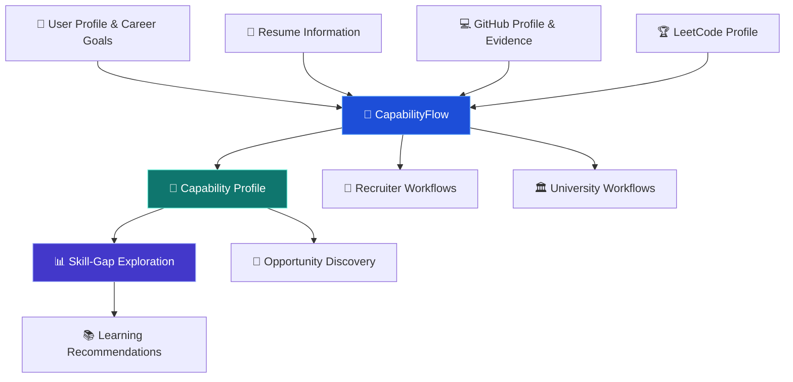

<div align="center">

# 🚀 CapabilityFlow
### Intelligent Talent & Capability Ecosystem

**From skills and evidence to capability insights and career opportunities.**

<a href="https://capability-flow-nine.vercel.app/">
  
</a>
<a href="https://github.com/vaibhavkumar-h/capability-flow">
  
</a>

<br/><br/>


</div>

---

## 💡 What Is CapabilityFlow?

CapabilityFlow is a talent and capability intelligence platform designed to connect **students, recruiters, and universities** through a more structured view of skills, experience, evidence, and opportunities.

Instead of treating a resume as the complete picture of a person, the platform explores how information from resumes, GitHub activity, LeetCode profiles, and career goals can contribute to a richer capability profile.

The goal is to help users understand what they know, identify areas for growth, and connect their capabilities with relevant learning and career opportunities.

<div align="center">

| 🎓 Students | 🏢 Recruiters | 🏛️ Universities |
|:---:|:---:|:---:|
| Explore capabilities and skill gaps | Explore talent and role requirements | Understand skills and capability development |

</div>

**🔗 Live application:** [capability-flow-nine.vercel.app](https://capability-flow-nine.vercel.app/)

---

## 🎯 The Problem

Traditional resumes and disconnected skill records can make it difficult to understand a person's full capabilities.

- 📄 Resumes may not capture every project, technical skill, or learning experience.
- 🔍 Recruiters need clearer ways to compare candidate skills with role requirements.
- 🧭 Students may struggle to identify the most important skills to develop next.
- 🏫 Universities need better ways to connect learning outcomes with changing industry requirements.

## 💎 The Solution

CapabilityFlow brings these needs into a unified web platform.

It combines profile information, resume-based skill extraction, technical profile analysis, capability views, skill-gap exploration, and opportunity-oriented workflows into one experience.

The platform is designed to make capabilities easier to explore and career development more evidence-oriented.

---

## ✨ Platform Features

<table>
<tr>
<td width="50%" valign="top">

### 🎓 Student Experience

- 👤 Student profile and career goals
- 📄 Resume upload and information extraction
- 💻 GitHub evidence exploration
- 🧩 LeetCode profile analysis
- 📊 Capability and skill views
- 🎯 Skill-gap exploration
- 📚 Learning and opportunity discovery

</td>
<td width="50%" valign="top">

### 🏢 Recruiter Experience

- 👥 Talent exploration interface
- 🔎 Candidate and capability views
- 🧠 Role and skill-demand workflows
- 📋 Shortlist-oriented interface
- 📌 Opportunity and post management views

</td>
</tr>
<tr>
<td width="50%" valign="top">

### 🏛️ University Experience

- 🎓 University-focused dashboard
- 🧑‍🎓 Student and capability views
- 📊 Skill-gap and program-related workflows
- 🔗 Connection between learning and employability goals

</td>
<td width="50%" valign="top">

### ⚙️ Platform Foundation

- ⚛️ React and TypeScript frontend
- 🎨 Component-based interface
- ✨ Framer Motion animations
- 🔌 Backend integration
- 🔐 Environment-based configuration
- 🚀 Web deployment workflow

</td>
</tr>
</table>

> Feature availability and behavior depend on the current implementation and configured services. The presence of a screen or workflow does not by itself establish that every external integration or recommendation runs end to end.

---

## 🧠 How CapabilityFlow Works



### 🔄 Typical User Journey

1. **Build a profile** — provide profile details, skills, experience, and career goals.
2. **Add evidence** — use resume information and supported technical-profile inputs.
3. **Explore capabilities** — review the skills and evidence represented in the platform.
4. **Identify gaps** — explore differences between current skills and desired roles.
5. **Discover next steps** — investigate learning recommendations and relevant opportunities.
6. **Connect stakeholders** — use the platform's recruiter and university-oriented workflows.

*This diagram describes the intended capability workflow. The exact processing, integrations, and outputs depend on the configured application services.*

---

## 🛠️ Technology Stack

| Technology | Purpose |
|---|---|
| ⚛️ React | Component-based frontend |
| 🔷 TypeScript | Typed application development |
| ⚡ Vite | Development server and production build |
| 🎞️ Framer Motion | UI animations and transitions |
| 🎨 CSS | Styling and layout |
| 🐍 Python/backend components | Backend services, where configured |
| 🔐 Environment variables | Service and deployment configuration |
| ▲ Vercel | Live frontend hosting |
| 🐙 Git & GitHub | Version control and collaboration |

The repository also includes a `backend/` directory, a `render.yaml` deployment configuration, and a `role-skill-graph/` directory. Refer to the corresponding source files and configuration for their exact responsibilities.

---

## 🗂️ Repository Structure

```text
capability-flow/
├── backend/                 # Backend application and services
├── role-skill-graph/        # Role/skill graph-related project assets
├── src/
│   ├── lib/                 # Shared application utilities
│   ├── student/             # Student-facing experience
│   ├── recruiter/            # Recruiter-facing experience
│   ├── university/           # University-facing experience
│   ├── App.tsx              # Main application component
│   ├── main.tsx             # Frontend entry point
│   └── styles.css           # Global styling
├── .env.example             # Example environment configuration
├── index.html
├── package.json
├── render.yaml
├── tsconfig.json
├── vercel.json
└── vite.config.ts
```

*This is a simplified overview. Additional files and directories may exist in the repository.*

---

## 🚀 Run Locally

### Prerequisites

- [Node.js](https://nodejs.org/)
- npm
- [Git](https://git-scm.com/)
- Python and any backend dependencies required by the project, if running the backend locally

### 1. Clone the repository

```bash
git clone https://github.com/vaibhavkumar-h/capability-flow.git
cd capability-flow
```

### 2. Install frontend dependencies

```bash
npm install
```

### 3. Configure environment variables

Review `.env.example` and the backend configuration to identify the required variables.

Create a local `.env` file only when needed and populate it with your own development credentials. Never commit real secrets.

### 4. Start the frontend

```bash
npm run dev
```

Open the local URL shown in the terminal.

### 5. Build for production

```bash
npm run build
```

### 6. Preview the production build

```bash
npm run preview
```

### Backend setup

The repository contains a backend directory. Review its included instructions and dependency files before starting backend services. Backend commands and environment requirements should be taken from the actual project configuration rather than assumed.

---

## 🔐 Security & Configuration

- Never commit `.env` files containing secrets.
- Keep API keys, database credentials, and access tokens private.
- Use `.env.example` to document variable names without publishing real values.
- Validate user-uploaded files and inputs.
- Apply appropriate authentication and authorization to protected operations.
- Verify external service configuration before deploying changes.

---

## 🔮 Future Scope

- [ ] More detailed, evidence-linked capability profiles
- [ ] Improved role-to-skill matching
- [ ] Personalized learning paths and progress tracking
- [ ] Stronger explanations for skill-gap results
- [ ] Expanded recruiter and university analytics
- [ ] Additional integrations with learning and professional platforms
- [ ] Improved testing, accessibility, and deployment observability

These items represent potential improvements and should not be interpreted as already completed features.

---

## 🌍 Live Demo & Source Code

<div align="center">

### Explore CapabilityFlow

<a href="https://capability-flow-nine.vercel.app/">
  
</a>

<a href="https://github.com/vaibhavkumar-h/capability-flow">
  
</a>

</div>

---

## 👨‍💻 Project

**CapabilityFlow — Intelligent Talent & Capability Ecosystem**

Developed as a multi-stakeholder platform exploring the relationship between technical skills, demonstrated evidence, career development, and opportunities.

**Repository:** [vaibhavkumar-h/capability-flow](https://github.com/vaibhavkumar-h/capability-flow)

**Live application:** [capability-flow-nine.vercel.app](https://capability-flow-nine.vercel.app/)

---

<div align="center">

### 🚀 Skills. Evidence. Opportunities.

<sub>CapabilityFlow — helping make capabilities easier to understand and develop.</sub>

</div>
